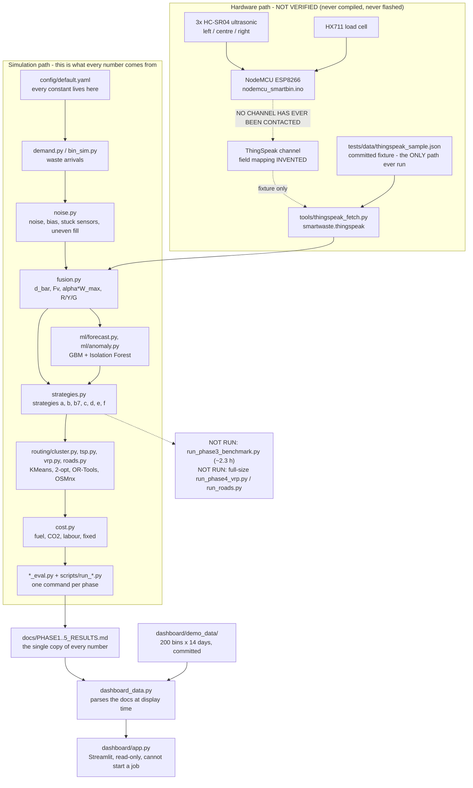

# smart-waste-iot-routing

Sensor-fused smart bins decide which bins a truck visits, and the trucks are routed only to
those — rebuilt as a reproducible simulation that reports its own negative results.

## The problem

Fixed-route trucks visit every bin every day, whether or not there is anything in it. That wastes
fuel, money, labour and CO2. A bin that reports how full it is lets the fleet collect only what
needs collecting, and lets the route be optimised around that day's actual set of full bins.
That is the system this repo models end to end: three ultrasonic sensors and a load cell on a
NodeMCU, a fusion rule that turns their readings into GREEN / YELLOW / RED, a city simulation, a
cost model, forecasting, anomaly detection, capacitated routing on real roads, and a dashboard.

The interesting part is not that it saves money. It is **where it does not** — a sensor-free
calendar matches the paper's sensor fusion on cost, an industrial solver barely beats fifty lines
of 2-opt, and a two-rule stdlib detector beats Isolation Forest. Those results are in
[Key findings](#key-findings) rather than buried.

## The paper this extends

> **"Sensor-Fusion Driven Smart Waste Collection Optimization for Metropolitan Cities: A
> Hardware-Integrated and Economic Impact Analysis Framework"**
> Dharun Kumar V, **Gnanakamalesh M**, Abinash SJ, et al., Sri Sairam Institute of Technology.

I am a **co-author** of that IEEE conference paper. This repo is my own extension of it, written
afterwards and independently: the paper's hardware work built **one** physical bin, and this repo
is the simulation, baselines, ML and routing the paper did not have — plus an honest account of
the paper's weaknesses, which are listed in [`docs/SPEC.md`](docs/SPEC.md) section 2.

The paper reports travel time 16,192 -> 10,680 hr (34.04%), cost 21,144,450 -> 16,446,330
(22.22%), CO2 571,259 -> 389,294 kg (31.85%). **Those are reference only.** This project does not
reproduce them, does not promise to, and tuned no constant toward them — see
[`docs/PHASE2_RESULTS.md`](docs/PHASE2_RESULTS.md), where our own figures come out roughly double
and the gap is reported rather than closed.

## Architecture



In words, and the shape matters more than the boxes:

- **Two paths, and only one of them has ever produced a number.** The simulation path is
  config-driven, seeded and stdlib-first. The hardware path exists as code and has never run
  against hardware: the sketch has never been compiled or flashed, and no ThingSpeak channel has
  ever been contacted, so the only executed branch is `--offline` against a committed fixture.
- **One fusion rule, used everywhere.** `smartwaste.fusion.fuse` classifies simulated readings,
  fixture readings and the firmware cross-check alike; the sketch's arithmetic is transcribed into
  `smartwaste.firmware_reference` so the two copies can be compared instead of trusted.
- **Every constant comes from `config/default.yaml`** and is recorded in
  [`docs/ASSUMPTIONS.md`](docs/ASSUMPTIONS.md). Nothing is tuned in a script.
- **The docs are the database.** Each phase's runner writes gitignored output under `results/`;
  the committed numbers live in the results docs, and the dashboard parses those docs rather than
  keeping a second copy that could drift.
- **The dashboard cannot start a simulation.** `dashboard/app.py` imports exactly one project
  module, `smartwaste.dashboard_data`, which is stdlib only — so there is no simulator on the page's
  import path at all.

## What I built, per phase

| Phase | What it added | The one command |
|---|---|---|
| 0 | Skeleton: `pyproject.toml`, config loader (`src/smartwaste/config.py`), seeds, ruff + mypy strict + pytest chunks, CI on Python 3.11 | `python -m pytest -m unit` |
| 1 | Single-bin simulation, the sensor noise model, the paper's fusion rule, and the single-sensor vs 3-sensor-mean vs mean+load-cell experiment with bootstrap CIs | `python scripts\run_fusion_eval.py` |
| 2 | The city simulation, the cost / fuel / CO2 / time model, five labelled strategies, KMeans clustering and depot-constrained TSP (nearest neighbour then 2-opt) | `python scripts\run_benchmark.py --seed 42` |
| 3 | Heterogeneous demand (area types, weekday cycle, festival spikes), fill forecasting on a time-based split against three naive baselines, and anomaly detection on planted faults with the labels in a separate file | `python scripts\run_forecast.py --seed 42` and `python scripts\run_anomaly.py --seed 42` |
| 4 | Truck capacity as a real constraint, multi-truck capacitated VRP via OR-Tools, an algorithm comparison on identical bin sets, and real Chennai road distances via OSMnx with a disk cache | `python scripts\run_phase4_vrp.py --seed 42 --quick` and `python scripts\run_roads.py --seed 42 --quick` |
| 5 | The Streamlit dashboard and its committed demo snapshot, the NodeMCU sketch and its gitignored-config pattern, the ThingSpeak library and CLI, and a firmware cross-check | `python scripts\make_demo_data.py --seed 42` then `python -m streamlit run dashboard\app.py` |
| 6 | This README, the architecture diagram, and the README checker that fails if a link or a number stops matching its source doc | `python scripts\check_readme.py` |

## Key findings

Every row names the document the figure is pasted from, the scope it holds over, and the command
that produced it. **Nothing here was recomputed for the README**; the checker in
`src/smartwaste/readme_check.py` fails if a number stops appearing verbatim in the doc on its row.

| # | Finding | Scope | Source and command |
|---|---|---|---|
| 1 | **The paper's 3-sensor mean fails badly when one side sensor sticks**: 26.73% misclassification against the single centre sensor's 5.88% — 20.85 pp worse — missing 69.34% of genuinely full bins. A plain mean has no fault tolerance. | synthetic, invented noise model, one seed, 200 bins x 30 days | [`docs/PHASE1_RESULTS.md`](docs/PHASE1_RESULTS.md) · `scripts\run_fusion_eval.py` |
| 2 | **The load cell's headline gain rests on a constant we invented.** With zero sensor noise it scores 0.00% where the ultrasonic-only methods score 2.32%, but at `--density-cv 0.0` all three score 0.00%. Its fault-tolerance gain survives that; its accuracy gain does not. | synthetic, one seed; sensitivity run reported beside the headline | [`docs/PHASE1_RESULTS.md`](docs/PHASE1_RESULTS.md) · `scripts\run_fusion_eval.py --density-cv 0.0` |
| 3 | **A sensor-free calendar matches the paper's sensor fusion.** Collecting every bin every 3 days cuts cost 66.67% against the naive baseline where the paper's fusion cuts it 67.42% — and it overflowed **0** times against fusion's **90**. Phase 2 does not demonstrate a business case for the sensors. | synthetic, 5000 bins x 30 days, seed 42, stuck fraction 0.02; range over seeds 42-46 reported too | [`docs/PHASE2_RESULTS.md`](docs/PHASE2_RESULTS.md) · `scripts\run_benchmark.py --seed 42` |
| 4 | **Our savings are roughly double the paper's, and are not reconciled.** Travel time 77.42% against its reported 34.04%; most of it is the naive baseline plus a 100 km uniform-random grid. Reported, not tuned away. | synthetic, same run as above; the paper's figures are reference only | [`docs/PHASE2_RESULTS.md`](docs/PHASE2_RESULTS.md) · `scripts\run_benchmark.py --seed 42` |
| 5 | **Our own median-fusion extension is not a clean win.** It loses to the paper's mean at zero faults (29.0 overflow events against 8.4, winning 0 of 5 seeds) and wins at 0.02 and 0.1 (5 of 5 seeds), and it misses more RED bin-days everywhere. The crossover sits on an invented number, so all three fault fractions are published. | synthetic, 5 seeds (42-46) — a range, never called a confidence interval | [`docs/PHASE2_RESULTS.md`](docs/PHASE2_RESULTS.md) · `scripts\run_benchmark.py --seed 42` |
| 6 | **The ML forecaster does earn its keep on accuracy**: MAE 6.568 pp of fill against the best naive baseline's 11.936 on heterogeneous demand — and it did so having trained on **zero** festival days, which was measured and left unfixed rather than tuned away. | synthetic invented demand, 400 bins x 30 days, seed 42, time-based split; same-machine floats | [`docs/PHASE3_RESULTS.md`](docs/PHASE3_RESULTS.md) · `scripts\run_forecast.py --seed 42` |
| 7 | **A two-rule stdlib detector beats Isolation Forest on every fault family**, both fair tests included: PR-AUC 0.5664 against 0.1523 overall. Both are near-blind to drift (0.0311 and 0.0152 against a prevalence of 0.0071). | synthetic planted faults, 22400 scored windows, thresholds chosen on a separate seed | [`docs/PHASE3_RESULTS.md`](docs/PHASE3_RESULTS.md) · `scripts\run_anomaly.py --seed 42` |
| 8 | **NOT RUN:** whether forecast-driven collection is actually worth it. The city-scale strategy benchmark costs about 2.3 hours and was never run, so there is no overflow, distance or cost figure for the forecast strategies — and no verdict on finding 3 under heterogeneous demand, in either direction. | nothing measured; the code and its ten strategies are built and tested | [`docs/PHASE3_RESULTS.md`](docs/PHASE3_RESULTS.md) · `scripts\run_phase3_benchmark.py --seed 42` |
| 9 | **SMOKE RUN — OR-Tools barely beats the hand-written 2-opt**: 0.29% shorter, against a 2.00% "meaningful" threshold that was a module constant before the first run. Plain 2-opt over nearest neighbour is worth twenty times more (5.88%). OR-Tools is kept for being able to express the capacitated problem, not for distance. | SMOKE RUN: 5 clusters, 46 bins, one day, one seed; OR-Tools rows same-machine-only | [`docs/PHASE4_RESULTS.md`](docs/PHASE4_RESULTS.md) · `scripts\run_phase4_vrp.py --seed 42 --quick` |
| 10 | **SMOKE RUN — truck capacity never binds, so the noisy-plan-vs-oracle comparison is a tie.** A cluster's whole day is 296.24 kg against an 8000 kg truck (3.7%), so both plan bases executed 560.19 km with zero breaches. That is a **null result**, not evidence that sensor fusion is good enough for dispatch: nothing was riding on the weight estimate. | SMOKE RUN: same 46-bin instance set, one day, one seed | [`docs/PHASE4_RESULTS.md`](docs/PHASE4_RESULTS.md) · `scripts\run_phase4_vrp.py --seed 42 --quick` |
| 11 | **SMOKE RUN — a straight line under-states road distance by 1.4514x at the median** on real T. Nagar drive roads (p10 1.2340, p90 2.1370, max 12.0161; 1.5364 on total distance, 1.8326 on a routed tour). It does **not** transfer to the 100 km grid and no table applies it there. | SMOKE RUN: ONE ~3 km Chennai area, 50 **synthetic** bin locations on real roads, one seed | [`docs/PHASE4_RESULTS.md`](docs/PHASE4_RESULTS.md) · `scripts\run_roads.py --seed 42 --quick` |
| 12 | **DEMONSTRATION, not a result — Yellow bins are still never collected, and it shows.** In the dashboard's snapshot the YELLOW count climbs to 57 of 200 bins by day 13, with 11 overflow events over the 14 days. The opportunistic Yellow-bin logic the spec puts in Phase 3 has never been built. | demonstration only: 200 bins x 14 days, seed 42, comparable with nothing | [`docs/PHASE5_RESULTS.md`](docs/PHASE5_RESULTS.md) · `scripts\make_demo_data.py --seed 42` |

## How to read this repo (for interviewers)

**What is real.** The code, the tests and CI. Every module under `src/smartwaste/` runs; the six
pytest chunks pass; `ruff` and `mypy --strict` are clean; the determinism claims were checked by
running a command twice and comparing bytes with `fc` / `cmp`, and the independence claims by
actually uninstalling the optional wheels and re-running the chunks. Where a result came out
against the project's own thesis, it is the headline of its section.

**What is invented.** Essentially every constant. The paper states the *form* of its cost model
and none of its constants, so the whole `cost` section, the whole `demand`, `forecast` and
`anomaly` sections, the whole `vrp` and `roads` sections, and the ThingSpeak field mapping are
ours with **no citation and no measurement** behind them —
[`docs/ASSUMPTIONS.md`](docs/ASSUMPTIONS.md) carries a banner per group saying so, and no row in
that file is marked `VALIDATED`. Absolute INR and kg figures therefore carry no external meaning;
only comparisons between strategies do.

**What was never run.** The Phase 3 city-scale strategy benchmark; the publication-size Phase 4
runs (every Phase 4 table is a smoke run); the firmware (never compiled, never flashed); ThingSpeak
(no channel ever contacted); the Yellow-bin logic (never built); Docker (no Dockerfile exists); and
`streamlit run` in a browser (the dashboard has only been exercised headlessly). `docs/INTERVIEW.md`,
which `docs/PHASES.md` lists under Phase 6, was deliberately left out of this phase's scope.

**How to check me.** Every figure above and below is pasted from a committed document, with the
command beside it. `python scripts\check_readme.py` re-verifies that each one still appears
verbatim in the document its line links to.

## How to run (Windows cmd)

From the repo root. `python` throughout — no `make`, nothing bash-only.

```
py -3.11 -m venv .venv
.venv\Scripts\activate
python -m pip install -e ".[dev]"
```

Phase 1 — the sensor-fusion experiment, and its sensitivity run:

```
python scripts\run_fusion_eval.py
python scripts\run_fusion_eval.py --density-cv 0.0
```

Phase 2 — the city benchmark (about 7.8 min on one Windows machine):

```
python scripts\run_benchmark.py --seed 42
```

Phase 3 — forecasting and anomaly detection (needs the `ml` extra):

```
python -m pip install -e ".[dev,ml]"
python scripts\run_forecast.py --seed 42
python scripts\run_anomaly.py --seed 42
```

The Phase 3 strategy benchmark is **NOT RUN** and costs about 2.3 hours. `--quick` gives a smoke
run whose tables are labelled not for publication:

```
python scripts\run_phase3_benchmark.py --seed 42 --quick
python scripts\run_phase3_benchmark.py --seed 42
```

Phase 4 — VRP and real roads (needs the `roads` extra). The `--quick` form is what every published
Phase 4 number came from; the full form has **NOT been run**:

```
python -m pip install -e ".[dev,roads]"
python scripts\run_phase4_vrp.py --seed 42 --quick
python scripts\run_roads.py --seed 42 --quick
python scripts\run_phase4_vrp.py --seed 42
python scripts\run_roads.py --seed 42
```

Phase 5 — the demo snapshot, the dashboard, and the ThingSpeak CLI against its fixture (needs the
`app` extra):

```
python -m pip install -e ".[dev,app]"
python scripts\make_demo_data.py --seed 42
python -m streamlit run dashboard\app.py
python tools\thingspeak_fetch.py --offline tests\data\thingspeak_sample.json
```

Checks — the six chunks exist so no single pytest process has to carry everything:

```
python -m pytest -m unit
python -m pytest -m sim
python -m pytest -m ml
python -m pytest -m routing
python -m pytest -m slow
python -m pytest -m dash

python -m ruff check .
python -m ruff format --check .
python -m mypy

python scripts\check_readme.py
```

On this Windows machine, with `.[dev,ml,roads,app]` installed, those six chunks pass **451 / 125 /
14 / 107 / 5 / 17** tests (710 collected in total; a few carry two markers, so the chunk counts
overlap). That is output from this phase's own run of the commands above, not a figure carried
over from an earlier doc.

## Project layout

```
smart-waste-iot-routing/
  README.md                      this file
  CLAUDE.md                      standing rules for the repo
  SETUP.md                       one-time Windows setup
  pyproject.toml                 deps, extras, ruff / mypy / pytest config
  config/default.yaml            EVERY assumption lives here
  docs/
    SPEC.md  PHASES.md           the plan and the per-phase prompts
    ASSUMPTIONS.md               every constant, its status and why
    PHASE1..5_RESULTS.md         the single copy of every published number
  src/smartwaste/
    config.py  seeds.py          config loader, sha256 sub-seeds
    bin_sim.py  demand.py        waste arrivals (smooth and heterogeneous)
    noise.py  fusion.py          sensor model, then the paper's fusion rule
    city_sim.py  strategies.py   the city loop and the ten strategies
    cost.py  benchmark.py        cost / fuel / CO2 / time, and the Phase 2 runner
    phase3.py  phase4.py         the later benchmarks
    ml/forecast.py  ml/anomaly.py  ml/metrics.py
    routing/cluster.py  tsp.py  vrp.py  roads.py
    fusion_eval.py  forecast_eval.py  anomaly_eval.py  roads_eval.py
    thingspeak.py  firmware_reference.py
    dashboard_data.py  readme_check.py
  scripts/run_*.py               one runner per phase, plus check_readme.py
  dashboard/app.py               Streamlit page
  dashboard/demo_data/           committed demo snapshot
  firmware/nodemcu_smartbin/     the sketch, its example config header, wiring README
  tools/thingspeak_fetch.py      CLI over smartwaste.thingspeak
  tests/                         pytest, six markers
  .github/workflows/ci.yml       lint, mypy, and one job per chunk
```

`data/`, `cache/` and `results/` exist with a `.gitkeep` and are otherwise gitignored, which is why
the published numbers live in the docs rather than in `results/`.

## Optional extras

The base install is `pyyaml` and the standard library. Every heavy wheel is optional and imported
**lazily**, inside the function that needs it, so the chunks that are supposed to prove they do not
need a wheel genuinely do not.

| Extra | Installs | Needed by | Verified without it |
|---|---|---|---|
| `dev` | pytest, pytest-cov, ruff, mypy, types-PyYAML | everything; every chunk installs it | — |
| `ml` | numpy, scikit-learn | the `ml` chunk, the gradient-boosting forecaster, Isolation Forest | yes — the other chunks were re-run with both uninstalled, per [`docs/PHASE3_RESULTS.md`](docs/PHASE3_RESULTS.md) |
| `roads` | ortools, networkx, osmnx | the Phase 4 VRP, the OSMnx road graph; part of the `routing` chunk | yes — re-run with all three uninstalled, per [`docs/PHASE4_RESULTS.md`](docs/PHASE4_RESULTS.md) |
| `app` | streamlit, plotly | the dashboard and the `dash` chunk | yes — re-run with both uninstalled, per [`docs/PHASE5_RESULTS.md`](docs/PHASE5_RESULTS.md) |

`scikit-learn` stands in for the XGBoost that `docs/SPEC.md` section 5 names: the same model
family, one fewer heavy wheel. The substitution is recorded as a deviation rather than quietly
made.

## CI

[Run 38689900399](https://github.com/Gnanakamalesh-M/smart-waste-iot-routing/actions/runs/38689900399)
— CI #5, branch `main`, commit `3de97a7`, status **Success**, total duration 1m 8s, as of
2026-10-15 (user-reported, from the Actions tab). Every job green: `ruff`, `mypy`, and pytest
`unit`, `sim`, `ml`, `routing`, `dash` and `slow`. Earlier runs were green too — CI #1 `ce578fd`,
CI #2 `5a3758a`, CI #3 `6443be0`, CI #4 `074837a` (the first run with the `roads` extra), CI #5
`3de97a7` (the first with the `dash` chunk).

**What green proves:** that `ruff check`, `ruff format --check` and `mypy --strict` pass, and that
the `unit`, `sim`, `routing`, `ml`, `slow` and `dash` chunks pass **on Linux** as well as on this
Windows machine, with one optional extra per chunk so no chunk hides a dependency.

**What green does not prove, and must not be read as proving:** that the full-size Phase 3 and
Phase 4 benchmarks were run — they were not, and no test runs them; that the firmware works — no
test compiles it; or that ThingSpeak works — no test touches the network, and no channel has ever
been contacted. CI runs the tests, and the tests deliberately avoid every one of those things.

The results docs were written before CI had ever executed and each says so; a dated correction
line was added beneath the original wording rather than editing it away.

## Limitations and NOT VERIFIED

Taken from the results docs' own `## NOT VERIFIED` sections. Read those for the full lists —
[Phase 1](docs/PHASE1_RESULTS.md), [Phase 2](docs/PHASE2_RESULTS.md),
[Phase 3](docs/PHASE3_RESULTS.md), [Phase 4](docs/PHASE4_RESULTS.md),
[Phase 5](docs/PHASE5_RESULTS.md) — plus
[`docs/ASSUMPTIONS.md`](docs/ASSUMPTIONS.md).

**Hardware**

- **Only 1 physical bin was built** (in the paper's hardware work), and **zero readings from it**
  appear anywhere in this repo.
- **The NodeMCU firmware has NEVER been compiled and NEVER been flashed.** `arduino-cli` was
  unavailable and no compilation was attempted; no ESP8266 toolchain, no board, no waste, no
  reading. Every statement about what the sketch does is a statement about what its text says.
- **The firmware cross-check tests a Python transcription, not the C++.** It cannot catch a C++
  type error, a `float`-vs-`double` difference, a pin mis-assignment or a library quirk; the
  companion constants test applies a regular expression to a text file.
- **The wiring table in `firmware/nodemcu_smartbin/README.md` is untested** — pins, the HC-SR04
  ECHO level-shifter advice and the HX711 calibration procedure are reasoned from datasheets, not
  from a built circuit.
- **No ThingSpeak channel has ever been contacted.** No channel, no real key, no ingested reading;
  `--offline` against a committed fixture is the only path ever executed, and **the field mapping
  is invented and uncited** — a real channel could silently disagree and nothing would detect it.

**Data and scale**

- **All data is synthetic.** Fill levels, sensor readings, faults and bin locations are generated,
  not collected. **The 5000-bin, 30-day results are simulation**, not measurements from deployed
  bins.
- **Every cost, demand, forecast, anomaly, VRP and roads constant is invented and uncited.** The
  absolute INR and kg figures carry no external meaning; only the comparison between strategies
  does, and even that shifts if the relative sizes of the fuel, labour and fixed terms are wrong.
- **The entire sensor error model is invented.** The paper publishes none, so Phase 1's result is
  "fusion helps under this assumed noise model", never "fusion helps".
- **Distances are Euclidean on a uniform-random 100 x 100 km grid in Phases 1-3.** Not road
  distances, not a city layout. Phase 4's measured road detour was taken on a different geometry at
  a different scale and **does not** license multiplying the earlier numbers by it.
- **Five seeds is a range, not a confidence interval**, and is never described as one. Phase 4 is
  one day of one seed, so its numbers have no spread at all.
- **Bin locations on the road network are synthetic** — uniform-random points snapped to real
  OpenStreetMap road nodes. The roads are real; the bins are not.

**Not run, not built**

- **Phase 3's city-scale strategy benchmark was NOT RUN** (about 2.3 hours), so Phase 3 settles
  nothing about collection outcomes and reports no overflow, distance or cost figure for the
  forecast strategies.
- **Phase 4's publication-size runs were NOT RUN.** Every Phase 4 table is a `--quick` smoke run;
  the mechanism and direction of each finding are established, **no city-scale magnitude is.**
- **Yellow-bin opportunistic collection was never built**, though `docs/SPEC.md` section 7 lists it
  under Phase 3. It was out of scope in Phases 3, 4, 5 and 6, so YELLOW bins are still never
  collected except incidentally.
- **No Dockerfile exists.** `docs/SPEC.md` section 7 lists Docker under Phase 6; it was not built,
  so there is nothing to mark verified or unverified.
- **`docs/INTERVIEW.md` was not written**, though `docs/SPEC.md` section 7 and `docs/PHASES.md` list
  it under Phase 6. Out of this phase's scope.
- **The dashboard has only ever run headlessly**, via streamlit's in-process `AppTest`. No browser
  has rendered the page, so nothing is known about its layout at a real viewport or in dark mode.
- **Overflow has no cost attached.** It is reported as a count beside cost, never folded into it,
  because there is no defensible price for an overflowing bin.
- **ML and OR-Tools numbers are same-machine-only.** scikit-learn promises no bit-identical floats
  across platforms, and the OR-Tools search runs under a wall-clock limit, so another machine can
  return a different route. The stdlib paths keep the project's byte-identical guarantee.
- **`.gitattributes` is new and its cross-platform effect is untested** — the `eol=lf` rule is
  verified on this Windows machine only.

**Known stale spots in the older docs** (reported, not rewritten, so the record stays honest):
`docs/SPEC.md` section 5 still names XGBoost and lists `torch` and Docker, which do not exist;
section 6's target layout never matched the build (there is no `simulate.py`, `baselines.py`,
`metrics.py` or `scripts/run_sim.py`); and section 7 lists the Yellow-bin logic and
`docs/INTERVIEW.md`, neither of which was built.

## Credits

- **The IEEE conference paper** this extends: *"Sensor-Fusion Driven Smart Waste Collection
  Optimization for Metropolitan Cities: A Hardware-Integrated and Economic Impact Analysis
  Framework"* — Dharun Kumar V, Gnanakamalesh M, Abinash SJ, et al., Sri Sairam Institute of
  Technology. Its reported figures appear here as reference only.
- **Road geometry: © OpenStreetMap contributors**, licensed under the **Open Database License
  (ODbL) v1.0** — https://www.openstreetmap.org/copyright. Downloaded via OSMnx for one bounded
  Chennai area and cached to disk.
- Built with Python, scikit-learn, Google OR-Tools, OSMnx / NetworkX, Streamlit and Plotly.
